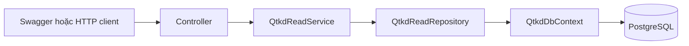

# QTKD · Thực hành tuần 05

ASP.NET Core Web API đọc khách hàng và hợp đồng từ PostgreSQL. Sử dụng cùng solution và database này để phát triển chức năng trong tuần 06 và kiểm thử trong tuần 07.

## Chạy trên máy mới

Cần .NET SDK 10, PostgreSQL 16 đang chạy, các công cụ dòng lệnh PostgreSQL và Git. Chạy các lệnh từ thư mục chứa `QTKD.sln`.

```sh
git clone https://github.com/tthoan23/thuc_hanh_he_thong_qtkd.git
cd thuc_hanh_he_thong_qtkd
dotnet tool restore
dotnet build QTKD.sln
```

Tạo tài khoản và database riêng cho QTKD bằng tài khoản quản trị PostgreSQL. `createuser` sẽ hỏi mật khẩu mới của `qtkd_app`. Với bản cài Homebrew, tài khoản quản trị thường trùng tên người dùng macOS. Nếu đã có tài khoản và database, dùng thông tin đang có và chuyển sang bước cấu hình.

```sh
PGADMIN=postgres
createuser --username="$PGADMIN" --pwprompt qtkd_app
createdb --username="$PGADMIN" --owner=qtkd_app qtkd
```

Nhập mật khẩu `qtkd_app` trong terminal Bash hoặc Zsh. Đổi cổng `5432` nếu PostgreSQL đang chạy trên cổng khác. EF CLI và Web API đọc cùng biến `ConnectionStrings__QtkdDb`.

```sh
printf 'Mật khẩu qtkd_app: '
read -rs QTKD_DB_PASSWORD
printf '\n'
QTKD_DB_PASSWORD_ESCAPED=${QTKD_DB_PASSWORD//\"/\"\"}
export ConnectionStrings__QtkdDb="Host=127.0.0.1;Port=5432;Database=qtkd;Username=qtkd_app;Password=\"$QTKD_DB_PASSWORD_ESCAPED\""
unset QTKD_DB_PASSWORD QTKD_DB_PASSWORD_ESCAPED
dotnet tool run dotnet-ef database update --project src/QTKD.Api
dotnet run --project src/QTKD.Api --launch-profile http
```

## Thử API và đối chiếu PostgreSQL

Mở Swagger tại `http://localhost:5055/swagger`. Trong từng endpoint, chọn **Try it out** rồi **Execute**.

- `GET /api/customers` trả `200` và danh sách theo `id`. Dữ liệu mẫu gồm Công ty An Bình (`Active`) và Công ty Đại Dương (`Inactive`).
- `GET /api/contracts/1` trả `200` với hợp đồng `HD-2026-017`, `customerId: 1`, `startDate: "2026-12-01"`, `endDate: null` và `status: "Draft"`.
- `GET /api/contracts/999999` trả `404` kèm JSON `ProblemDetails`.

Mở PostgreSQL bằng `psql -h 127.0.0.1 -p 5432 -U qtkd_app -d qtkd`, rồi chạy các lệnh sau. `\d` hiển thị cột, khóa chính và khóa ngoại. So sánh ID, tên và trạng thái trong kết quả truy vấn với JSON trên Swagger.

```sql
\dt
\d "Contracts"
\d "PriceItems"
SELECT "Id", "Name", "Status" FROM "Customers" ORDER BY "Id";
SELECT "Id", "ContractNo", "CustomerId", "StartDate", "EndDate", "Status"
FROM "Contracts" WHERE "Id" = 1;
SELECT p."Name", p."EffectiveDate", i."ServiceCode", i."UnitPrice"
FROM "PriceLists" p JOIN "PriceItems" i ON i."PriceListId" = p."Id"
ORDER BY i."ServiceCode";
```

## Luồng xử lý



Controller nhận yêu cầu và chọn mã HTTP. Service chuyển entity thành DTO để định hình JSON. Repository dùng `AsNoTracking()` cho truy vấn chỉ đọc và gọi EF Core bất đồng bộ. `QtkdDbContext` khai báo bảng, khóa và cách ánh xạ dữ liệu. `Program.cs` cấu hình Npgsql và đăng ký các lớp theo phạm vi mỗi request.

`InitialCreate` tạo schema và chèn dữ liệu mẫu vào PostgreSQL. Với `Customer`, `Contract` và `PriceList`, ID tự sinh bắt đầu từ 100 để dành khoảng ID thấp cho dữ liệu mẫu. `PriceItem` dùng cặp `PriceListId` và `ServiceCode` làm khóa chính, vì một dịch vụ xuất hiện tối đa một lần trong mỗi bảng giá.

## Giả định cho tuần 05

- Các trường và quan hệ dựa trên đề thực hành QTKD. Trạng thái khách hàng dùng `Active` và `Inactive`. Bản nháp có thể thiếu ngày bắt đầu hoặc ngày kết thúc để người dùng bổ sung sau.
- Công ty Minh Phát và `HD-2026-018` được dành cho thao tác tạo mới của tuần 06. Bản mẫu tuần 05 dùng Công ty An Bình và `HD-2026-017`.
- Khi triển khai tuần 06, đối chiếu US03, Acceptance Criteria, sơ đồ trạng thái và CTR-01–03. Xác nhận danh sách nội dung hoặc tài liệu bắt buộc của CTR-02 trước khi xác định điều kiện gửi trình duyệt.

## Kết quả kiểm chứng

- Build trên .NET SDK 10.0.402 với 0 lỗi và 0 cảnh báo. Áp dụng `InitialCreate` trên PostgreSQL 16.13. Chạy lại migration giữ nguyên bốn bảng nghiệp vụ, hai khóa ngoại và số dòng mẫu theo thứ tự Customer, Contract, PriceList, PriceItem là `2, 1, 1, 2`.
- Gọi hai endpoint trong Swagger và đối chiếu phản hồi `200` với kết quả SQL. ID hợp đồng không tồn tại trả `404` với `ProblemDetails`.
- Chạy lại từ bản sao mã nguồn sạch và database mới trên cùng máy. Sau khi đổi tên khách hàng trực tiếp trong database kiểm thử thứ hai, lời gọi GET kế tiếp trả về tên mới.
